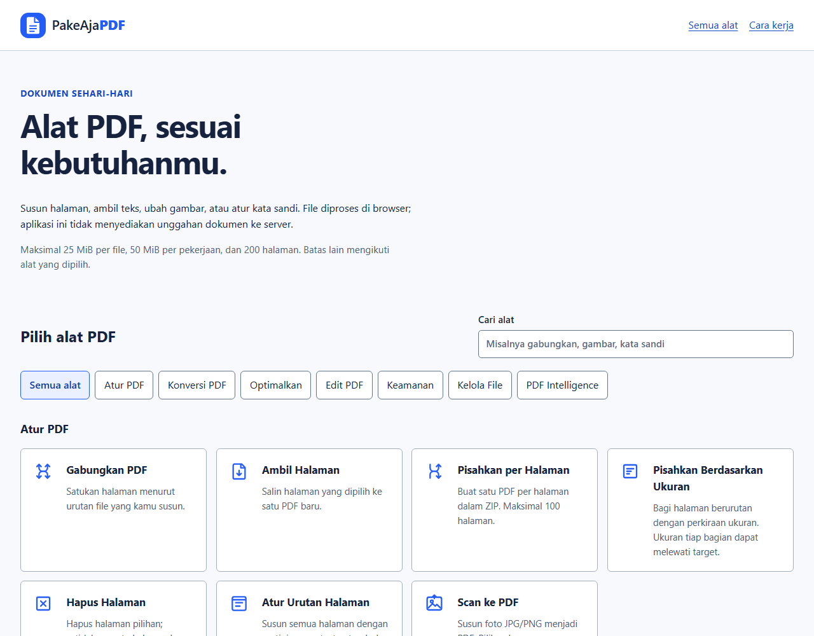
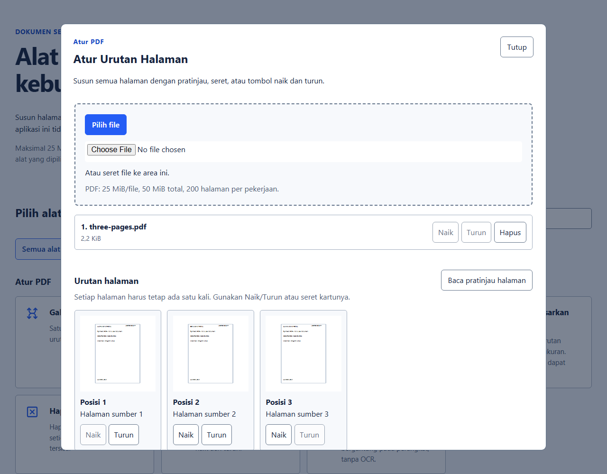
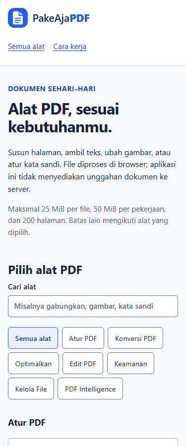

# PakeAjaPDF

25 alat PDF yang berjalan di browser: gabungkan dan susun halaman, ambil teks, konversi gambar, tambahkan tulisan, serta pasang atau buka kata sandi. Aplikasi memproses file secara lokal dan menyimpan hasil sebagai file baru. File sumber tetap utuh.



Katalog asli pada viewport 1280 × 1000. Pilih kategori atau cari nama alat untuk membuka pengaturannya.

## Jalankan

Gunakan Node.js 22.13 atau lebih baru dan browser dengan dukungan modul, Web Worker dan WebAssembly. Pustaka browser sudah disertakan dengan versi, hash dan pemberitahuan lisensi. Tidak ada dependensi npm yang perlu dipasang.

Jalankan dari folder proyek:

```sh
node scripts/build.mjs
node scripts/serve.mjs
```

Buka [http://127.0.0.1:8881](http://127.0.0.1:8881). Server hanya mendengarkan di loopback. Gunakan server ini untuk memuat modul dan worker; membuka `src/index.html` dengan klik ganda tidak cukup. Variabel lingkungan `PORT` dapat mengganti port bawaan.

Untuk menjalankan uji yang disertakan:

```sh
node --test --test-concurrency=1
```

Build memeriksa berkas sumber dan hash vendor, lalu menyiapkan `dist` sebelum mengganti hasil build lama. Jika penggantian direktori tidak terkonfirmasi, pesan build menunjukkan cadangan yang harus diperiksa. Server menyajikan hanya berkas yang cocok dengan manifest build.

## Pakai alatnya

1. Pilih alat, lalu tambahkan file. Urutan daftar file menentukan urutan hasil gabungan PDF atau gambar.
2. Periksa pengaturan. Pada Atur Urutan Halaman, baca pratinjau lalu gunakan tombol Naik/Turun atau seret halaman.
3. Tekan Proses file. Tombol Batalkan menghentikan pekerjaan aktif dan mempertahankan file pilihan.
4. Periksa ukuran serta catatan hasil, lalu tekan Unduh hasil. Browser menentukan lokasi penyimpanan sesuai pengaturannya.

Mengubah file, pengaturan atau urutan membatalkan hasil sebelumnya. Aplikasi menjalankan satu pekerjaan pratinjau atau proses pada satu waktu.



Pratinjau asli dari dokumen sintetis pada viewport 1280 × 1000. Hasil PDF dibuat setelah pengguna selesai menyusun halaman dan menekan Proses file.

## Daftar alat

| Alat | Hasil dan perilaku |
| --- | --- |
| Gabungkan PDF | Satu PDF mengikuti urutan file, lalu urutan halaman setiap file. |
| Ambil Halaman | Satu PDF dari rentang seperti `1,3,5-7`. Urutan penyebutan dipertahankan; angka ganda tidak diulang. |
| Pisahkan per Halaman | ZIP berisi satu PDF per halaman, maksimal 100 berkas. |
| Pisahkan Berdasarkan Ukuran | ZIP berisi bagian halaman berurutan dengan target perkiraan 5, 10, 20 atau 25 MiB. Ukuran bagian dapat melewati target. |
| Hapus Halaman | PDF dengan halaman pilihan dihapus; setidaknya satu halaman harus tersisa. |
| Atur Urutan Halaman | PDF berisi seluruh halaman tepat satu kali sesuai susunan pratinjau. |
| Scan ke PDF | Foto PNG/JPEG menjadi PDF. Picker perangkat dapat menawarkan kamera; tanpa OCR atau pelurusan hasil scan. |
| PDF ke Gambar | JPG/PNG untuk satu halaman, atau ZIP untuk beberapa halaman, maksimal 100 gambar. |
| PDF ke Word | DOCX berisi teks yang dapat dipilih dan pemisah halaman sumber. Tata letak serta tabel PDF tidak direkonstruksi. |
| PDF ke Teks | TXT dengan penanda setiap halaman, termasuk halaman kosong di antara teks. |
| Gambar ke PDF | Satu PNG/JPEG per halaman dengan A4, Letter atau ukuran gambar. |
| Kecilkan Ukuran PDF | PDF hasil render gambar. Teks kehilangan kemampuan seleksi; formulir/anotasi dapat berubah dan hasil dapat lebih besar. |
| Ubah Ukuran Halaman | Isi ditempatkan proporsional pada A4, A3, Letter atau Legal. Fitur interaktif dapat berubah. |
| Coba Perbaiki PDF | Menulis ulang PDF yang masih dapat dibaca parser. Pemulihan isi rusak tidak dijamin. |
| Putar Halaman | Menambahkan rotasi 90, 180 atau 270 derajat pada semua halaman atau rentang pilihan. |
| Tambah Nomor Halaman | Nomor dalam font Helvetica pada enam posisi pilihan; nomor akhir maksimal 9999. |
| Tambah Watermark | Teks diagonal yang terlihat, maksimal 100 karakter. |
| Potong Halaman | Mengubah batas tampilan halaman. Isi di luar batas dapat tetap tersimpan; jangan gunakan sebagai redaksi informasi. |
| Tambah Teks | Satu baris maksimal 500 karakter pada halaman dan posisi pilihan. |
| Tanda Tangan Visual | Nama pada halaman terakhir, tanpa sertifikat atau verifikasi tanda tangan digital. |
| Lindungi PDF | Salinan AES-256 dengan kata sandi baru yang kamu simpan sendiri. |
| Buka Proteksi PDF | Salinan tanpa proteksi jika sumber dapat dibuka dengan kata sandi yang diberikan. Aplikasi tidak memulihkan kata sandi yang hilang. |
| Bandingkan PDF | TXT perbandingan teks dan keberadaan halaman, termasuk tambahan halaman kosong. Alat ini tidak membandingkan tampilan visual. |
| Ganti Nama PDF | Salinan byte yang sama dengan nama `.pdf` baru. Aplikasi tidak memeriksa atau memperbaiki struktur PDF pada alat ini. |
| PDF ke Markdown | Teks dengan judul per halaman, tanpa rekonstruksi tabel atau struktur heading dokumen. |

Watermark, nomor, teks dan tanda tangan memakai font standar PDF. Aplikasi menolak teks overlay di luar pengodean WinAnsi tanpa mengganti huruf diam-diam. Ekstraksi teks dan DOCX tetap dapat membawa Unicode dari sumber. PDF berbasis gambar memerlukan OCR untuk mengekstrak tulisan; aplikasi ini tidak menyediakan OCR.

## Batas pekerjaan

| Bagian | Batas |
| --- | --- |
| File masuk | 25 MiB per file, total 50 MiB, maksimal 20 file dan 200 halaman sumber per pekerjaan. Gabung minimal 2 file; bandingkan tepat 2 PDF; alat PDF lainnya menerima satu file. |
| PNG/JPEG | Maksimal 12.000 piksel per sisi dan total 20 juta piksel. PNG animasi tidak didukung. |
| Render halaman | Maksimal 3000 piksel per sisi dan 6 juta piksel per halaman. Turunkan skala jika melewati batas. |
| Hasil | Maksimal 50 MiB. ZIP berisi maksimal 100 berkas dengan total isi sebelum kompresi maksimal 50 MiB. |
| Teks | Maksimal 1 juta unit kode UTF-16 dan 100.000 item teks; DOCX maksimal 10.000 baris. Aplikasi menolak teks yang tidak muat. |
| Waktu | Batas pekerjaan 60 detik. Kompleksitas parser/decoder tetap memengaruhi penggunaan memori; angka ini bukan jaminan batas RAM browser. |

Kata sandi baru memakai minimal 8 karakter Unicode dan maksimal 127 byte UTF-8. Buka Proteksi PDF menerima sandi kosong. Aplikasi mempertahankan spasi, awalan `-`/`@` dan karakter non-ASCII persis; karakter kontrol, NUL serta Unicode yang tidak lengkap ditolak. Kolom sandi dikosongkan setelah percobaan atau dialog ditutup, tanpa menjamin penghapusan seluruh salinan string dari RAM browser.



Tampilan browser pada viewport 375 × 900 dengan ukuran font akar 100%; gambar ini bukan bukti pengujian pada perangkat ponsel fisik.

## Privasi dan penyimpanan

File yang kamu pilih diproses di tab dan worker browser. Aplikasi memuat pustaka dari server lokal yang sama, tidak menyediakan endpoint unggahan dokumen, akun, database atau integrasi provider. Aplikasi juga tidak menyimpan riwayat file atau kata sandi ke `localStorage`/`sessionStorage`.

Hasil unduhan mengikuti perilaku browser. Periksa kembali isi file hasil, terutama setelah rasterisasi, perubahan ukuran, crop atau penulisan ulang PDF.

## Kode, pemeriksaan dan lisensi

[Alur kode](docs/CODE_FLOW.md) menjelaskan snapshot pilihan, worker, validasi hasil dan pembersihan resource. [Catatan pemeriksaan](docs/VERIFICATION.md) membedakan 39 uji murni/mock, alur browser 25 alat, pemeriksaan hasil independen, dan pengujian gangguan. Pengujian memakai dokumen sintetis; cakupannya tidak menjamin semua PDF atau browser akan berperilaku sama.

Nama, ikon dan tujuan alat mengikuti proyek PakeAjaPDF lokal. [NOTICE.md](NOTICE.md) mencatat asal dan keterbatasan atribusi. Kode/aset aplikasi belum memiliki lisensi tersendiri yang tercatat; repositori ini tidak menetapkan lisensi MIT untuk seluruh proyek. Pemberitahuan pustaka tercantum di [THIRD_PARTY_LICENSES.md](THIRD_PARTY_LICENSES.md), dengan versi serta hash dalam [vendor-manifest.json](vendor-manifest.json).
