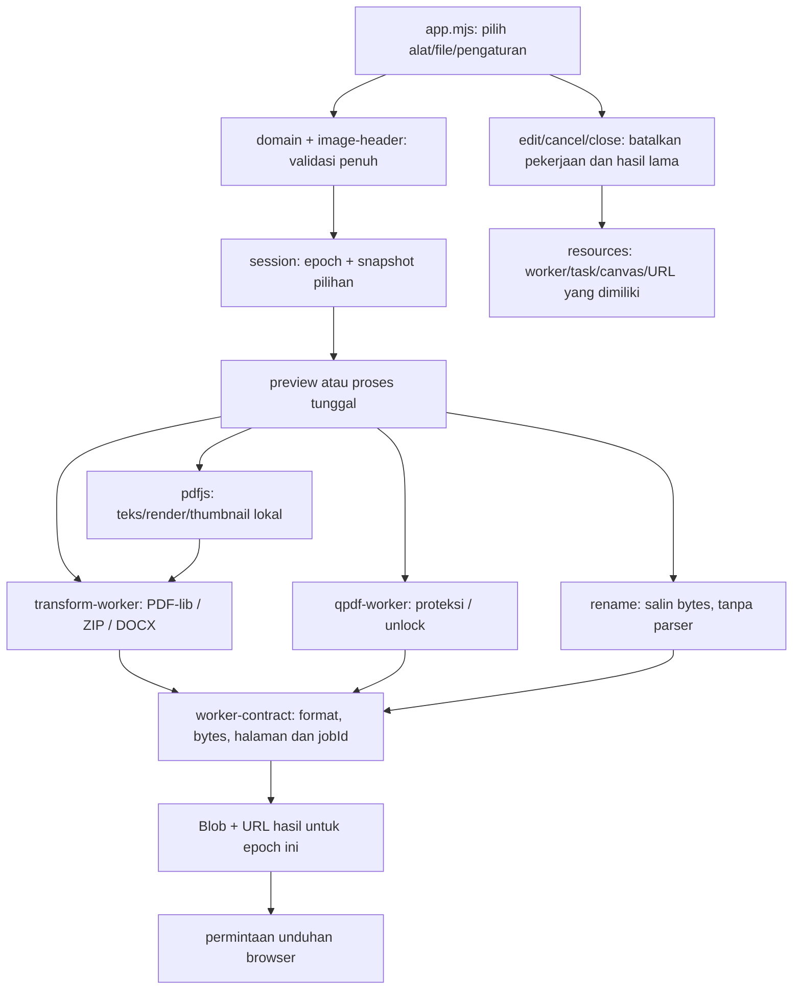

# Alur kode PakeAjaPDF

## Pilihan dan identitas pekerjaan

[catalog.mjs](../src/catalog.mjs) mendefinisikan 25 alat, format dan pilihan yang tersedia. [domain.mjs](../src/domain.mjs) menolak kolom asing, konversi tipe implisit, rentang/geometri salah, ukuran serta teks yang melewati batas. [image-header.mjs](../src/image-header.mjs) membaca header PNG/JPEG sebelum decoder menerima gambar.

[session.mjs](../src/session.mjs) menyimpan file dengan ID stabil, urutan, epoch dan satu pekerjaan aktif. Penambahan file invalid mempertahankan pilihan lama. Snapshot menyimpan nilai pengaturan dan referensi File immutable; engine tidak membaca DOM kembali setelah proses dimulai. Perubahan pilihan, pembatalan atau penutupan dialog membuat hasil lama tidak berlaku. Respons serta cleanup pekerjaan lama tidak boleh mengadopsi hasil ke epoch baru.

## Pembacaan dan transformasi

[pdfjs.mjs](../src/pdfjs.mjs) memakai worker, CMap, font, ICC dan WASM lokal. Teks dibaca melalui stream dengan batas item/karakter; render berjalan satu canvas setiap kali. Aplikasi mengadopsi pratinjau hanya jika seluruh preview masih cocok dengan pilihan, mengubahnya menjadi Blob URL, lalu melepas canvas. Susunan halaman dapat berubah tanpa merender ulang sumber. Mengganti file atau dialog melepaskan URL pratinjau.

[process.mjs](../src/process.mjs) menyiapkan byte sumber atau data antara yang sesuai. [transform-worker.js](../src/transform-worker.js) memuat pustaka lokal yang diperlukan, lalu [transforms.mjs](../src/transforms.mjs) menjalankan alat. Proteksi/pembukaan memakai [qpdf-worker.js](../src/qpdf-worker.js) dengan nama berkas MEMFS tetap. [native-options.mjs](../src/native-options.mjs) mempertahankan byte kata sandi dan menghasilkan owner secret terpisah; aplikasi tidak meneruskan log native mentah ke UI.

[geometry.mjs](../src/geometry.mjs) memisahkan koordinat tampilan dari kotak serta rotasi PDF. [domain.mjs](../src/domain.mjs) membandingkan teks dan keberadaan halaman, sehingga halaman kosong yang hanya ada pada satu dokumen tetap berbeda. Bandingkan PDF menghasilkan laporan teks, tanpa membandingkan visual halaman.

## Hasil, pembatalan dan cleanup

[worker-contract.mjs](../src/worker-contract.mjs) memeriksa identitas pekerjaan, opsi, format, ukuran dan penghitung hasil. Transformasi PDF membuka ulang hasil dan memeriksa jumlah halaman; jalur native memeriksa sumber/hasil dengan engine yang sama. Ganti Nama PDF merupakan pengecualian eksplisit karena alat menyalin byte persis tanpa memparse isinya.

[resources.mjs](../src/resources.mjs) memiliki task, worker, canvas dan URL, serta batas waktu pekerjaan. Cleanup melepaskan resource yang dimiliki tanpa mengubah hasil yang sudah selesai menjadi kegagalan palsu. Setelah validasi, aplikasi membentuk Blob dan URL hasil yang terikat pada epoch pilihan. Tombol Unduh hasil mengirim permintaan unduhan; browser menentukan keberhasilan dan lokasi penyimpanan.

Pemeriksaan ulang oleh engine aplikasi di atas merupakan pemeriksaan internal. [Catatan pemeriksaan](VERIFICATION.md) mencatat pengujian terpisah yang benar-benar dijalankan: pembacaan hasil dengan parser lain, struktur ZIP/DOCX, render seluruh halaman yang relevan dan peninjauan visual. Uji murni/mock yang disertakan tidak menggantikan bukti eksekusi tersebut.

## Build dan server lokal

[files.mjs](../scripts/files.mjs) membentuk daftar deployment yang tepat dan memeriksa hash vendor. [build-lib.mjs](../scripts/build-lib.mjs) menyiapkan staging, mempublikasikan direktori dan mempertahankan kandidat pemulihan jika penggantian direktori tidak terkonfirmasi.

[serve.mjs](../scripts/serve.mjs) mendengarkan di loopback, menerima GET/HEAD dan hanya menyajikan berkas `dist` yang cocok dengan manifest. Pemeriksaan hash mendeteksi perubahan byte meskipun ukuran file tetap. Server tidak mempunyai endpoint dokumen, akun, database atau provider. Seluruh engine dan resource dokumen dimuat dari origin lokal yang sama.
